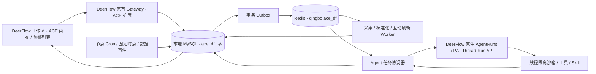

# ACE on DeerFlow：迁移架构

## 需求落实

画布是可编辑的任务定义和控制面。节点保留 ACE 的 type_id、提示词、Skill、输入输出契约、坐标与分组。每次触发固定图版本，产生独立任务；数据任务无需等待 Agent 沙箱。分支可以并发执行，单节点失败不撤销其他已完成任务。

## 模块与数据

- `deer-flow/`：2026-10-22 最新 main 的官方源码快照。来源与校验记录独立保存，保留原生功能。
- `extensions/ace/`：可安装 Python 扩展；业务逻辑不写进上游大文件。Gateway 生命周期管理协调器，API 与原有认证绑定。
- `extensions/ace/ui/`：TypeScript / React Flow 编排工作台，构建为 DeerFlow 官方 BrowserAssets 页面；API 仅经过 `src/lib/api.ts` 调用宿主授权的 action。
- `migration/source/`：旧画布的脱敏只读导出，保留源项目和 revision。
- `scripts/migrations/`：可重复的版本化 schema 迁移与导入；绝不写入旧 ACE 的 project/workflow 表。

权威存储：Project / GraphRevision、Article / ArticleRevision、Snapshot、Run、Task / Attempt、Event、Outbox、Schedule。每个业务对象都有 tenant/project 作用域。文章人工修订使用 revision 并发校验并追加审计；抓取更新不得抹掉人工修订。任务输出先与事件、下游任务在同一事务内落库，再通知队列。

## 状态与可靠性

Task：blocked → queued → running → succeeded / failed / cancelled / waiting_agent / waiting_review。
重试追加 attempt，旧输入快照及结果保留；回溯创建明确关联原任务的新运行，固定原图和原输入快照。任务领取使用租约和 fencing token，迟到回调不能覆盖新执行。Redis 是通知层，短暂不可用时任务仍可由数据库领取；Outbox 可重复发布，Worker 幂等处理。

普通 Worker 和 Agent 协调器分队列并限制并发。Agent 仅获得本节点数据快照、任务说明和授权上下文，不获取整图执行权或数据库凭据。记录 DeerFlow thread/run、开始结束时间、上下文、产物与模型使用信息。成功、失败、等待人工确认须区别处理。

## DeerFlow 能力边界

上游保留聊天、Custom Agent、工具、Skill、MCP、记忆、子 Agent、文件与沙箱。交互请求可绑定公开 extension-api AgentRuns；后台使用部署方配置的原生 PAT 调用公开 Thread/Run API，每次都由宿主校验所有权和权限。不能把数据库用户 ID 当作授权，也不使用裸 RunManager。稳定 thread_id、输入消息ID和幂等键关联 task/attempt；重启继续观察已知run，结果未知则等待核对。已验证原生文件工具以及真实模型研判/报告。

## CMC 样例

源项目 `proj_b33b4901cd79` revision 189，实际 15 节点。导入本地新扩展项目，旧平台项目保持不变。四路采集为数据任务；时间窗口、正文和标准化为普通 Worker；专项/基金判断交给 DeerFlow；文档与日周月报按各自节点触发。模拟数据明确标记，推送只生成未发送的预览记录。

正式时点固定为北京时间 08:30、10:30、12:30、14:30、16:30、18:30，按入库时间回看 150 分钟。定时推送仅在 09:00（含）至 20:00（不含）；首轮提前结束待到 09:00。手动执行不受时段限制。历史或模拟输入永远不能进入真实推送路径。

## 规范映射

旧仓库入口和冻结文件均不触碰。运行入口采用 DeerFlow 既有 Gateway，不增建第二个生产 HTTP 服务。上游以固定SHA为审查基线；通用授权钩子与页面装配逐文件记录，存量大文件净增≤50行并附本地拆分issue。新增模块/函数/组件按600/80/300行限制组织。无提交、推送或外发消息。

## 团队项目与原生对话

MySQL v4新增Team、Membership、Workspace、CanvasLink和NativeProject映射。一个用户可属于多个团队，角色按成员关系确定；请求重新校验有效成员关系。审核员只允许预警文章列表、修订和历史，原生聊天/模型/工具/项目API均拒绝。团队管理员可管理成员，不能自动获取平台管理员权限。

共享的项目、画布和文章位于ACE层，原生对话/项目资料继续个人所有。打开项目时创建或复用该用户的原生项目容器；新会话、附件、SDK幂等重建都校验项目归属。原生记忆、个人Agent/技能仍按账号组织；列表过滤发生在原生分页后，可能短页。这是可操作的团队权限示意，未声称完成所有企业多租户边界。

## SGM独立批次

v5新增持久AgentBatch，保存task/attempt/ordinal、确定性thread_id、原生run_id和结果。SGM按12篇/100KB上限分批，已有结果可恢复，租约失效不能回写。分页取数、标准化、过滤、分流、业务映射及预览由数据Worker执行；情感和问题提取调用原生Agent。

SIS未配置时沿用原画布fallback-to-source策略，保留标题正文及证据限制。预览前逐段校验模型摘录是否存在于源标题/正文；情感与问题证据矛盾进入人工核验，不生成发送卡片。所有消息均为预览。
